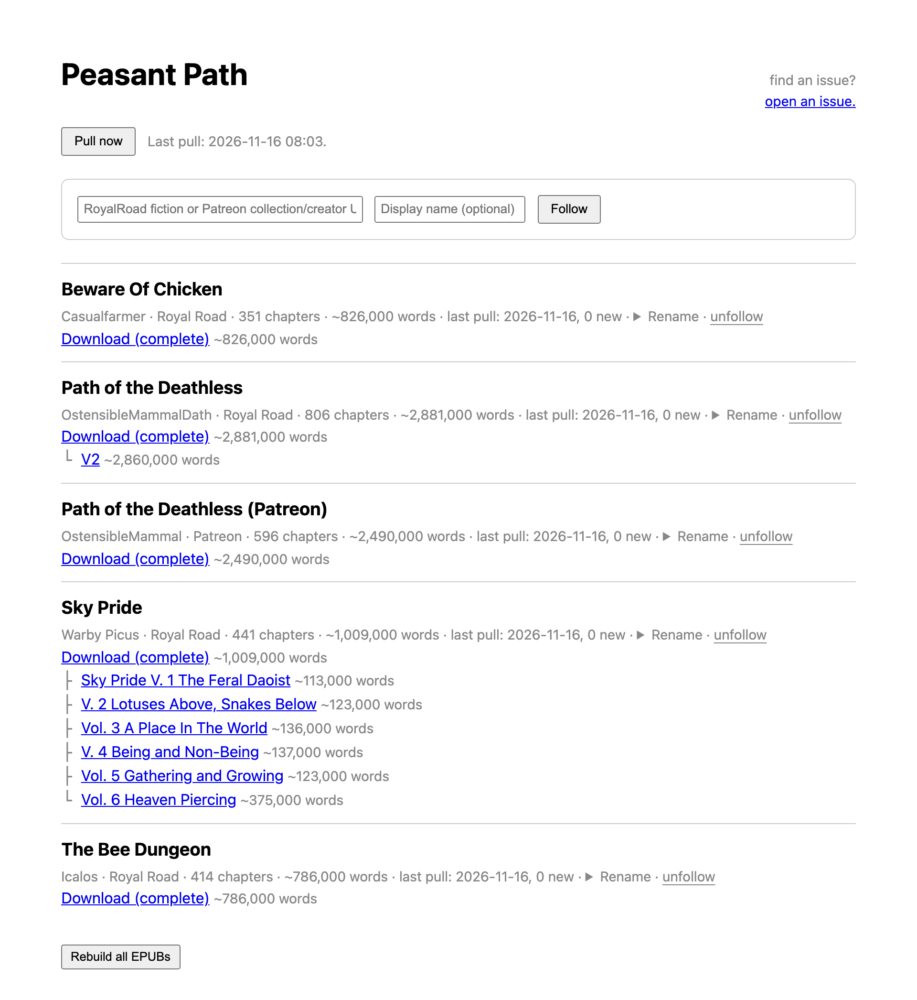

# Peasant Path - Because EPubs are nice.

Peasant Path is a small localhost web app that follows RoyalRoad fics and
Patreon collections or creator feeds, pulls new chapters on a schedule, and
turns them into EPUBs you can download: one for the whole story, plus one per
volume where the story has them.



State lives under `~/.config/peasant_path` (followed stories, scraped chapters,
covers, built EPUBs, and a pull log). The web UI and the CLI share that
directory, so anything you do in one shows up in the other.

## Getting started

```sh
git clone https://github.com/MordecaiMalignatus/peasant_path.git
cd peasant_path
bin/start                         # then open http://127.0.0.1:4567
```

`bin/start` installs whatever is missing, then starts the web UI:

- **System packages:** ICU and a compiler for the gems. On macOS that is
  Homebrew's `icu4c@78` plus the Xcode command line tools; on Debian/Ubuntu,
  the apt packages that are missing.
- **Ruby and Node**, at the versions pinned in `mise.toml`, if
  [mise](https://mise.jdx.dev) is installed. Without mise, it uses the
  system's Ruby (3.2 or newer) and Node (20 or newer), installing Node from
  Homebrew or apt if needed. Most Debian and Ubuntu releases ship a Node
  that is too old, so mise is the easier route there.
- **Gems**, through Bundler. With a system Ruby whose gem directory belongs
  to root, they go into `vendor/bundle` instead.
- **The Playwright driver and Chromium** that every pull runs in (see
  [Browser](#browser)), plus Chromium's system libraries on Debian/Ubuntu.

Each step checks first, so running `bin/start` again later goes straight to
the server. Options are passed on to `serve`, e.g. `bin/start --port 8080`;
`bin/start --setup-only` installs without starting anything. On Linux, the
apt installs ask for `sudo`.

The rest of this README writes the command as `peasant_path`. From a checkout,
that is `bundle exec bin/peasant_path`. If mise is installed but not
[activated](https://mise.jdx.dev/getting-started.html#activate-mise) in your
shell, prefix commands with `mise exec --` so they get the pinned Ruby and Node.

Paste a RoyalRoad fiction URL (e.g. `https://www.royalroad.com/fiction/107917/sky-pride`)
or a Patreon collection or creator URL into the form and hit **Follow**.
Following a story starts a background pull and build, so its download link
shows up shortly after. Patreon additionally needs a [login](#patreon).

## Web interface

The index lists every followed story with its author, source, chapter and word
counts, and the outcome of its last pull, including any error. From there you
can:

- **Pull now:** fetch new chapters for every story and rebuild the EPUBs of
  the ones that changed. Scheduled pulls do the same (see
  [Automatic pulling](#automatic-pulling)).
- **Follow** a new story, optionally with a display name of your own.
- **Download** the complete EPUB or a single volume.
- **Rename** a story, which rebuilds its EPUBs under the new title.
- **Unfollow** a story. Its downloaded chapters and EPUBs stay on disk.
- **Rebuild all EPUBs** from the chapters on disk, without pulling.

Only one job runs at a time; while a pull or build is running, **Pull now**,
**Rename** and **Rebuild all EPUBs** are disabled.

```sh
peasant_path serve [--port 4567] [--bind 127.0.0.1]
# or, from a checkout:
bundle exec rackup config.ru
```

From a checkout, the web UI can also run in a Podman container that uses the
same local state directory:

```sh
bin/run_container --build
```

This mounts `~/.config/peasant_path` into the container, so followed stories,
chapters, covers, pull logs, and built EPUBs are shared with local runs. The
image ships with the browser already installed.

> **Exposure caveat.** The app has no authentication and no Host-header check,
> and it mutates state (triggers scrapes, writes files). That's fine bound to
> the default `127.0.0.1`. If you `--bind` to a non-loopback address you're
> putting an unauthenticated, mutating, DNS-rebinding-susceptible app on the
> network — only do so behind a trusted reverse proxy / your own auth.
>
> **Session secret.** Flash messages use a signed session cookie. With no
> `PEASANT_PATH_SESSION_SECRET` set, each process generates a random one at
> boot, which is fine for a single worker but breaks flashes across a
> multi-worker Puma and invalidates sessions on restart. Set
> `PEASANT_PATH_SESSION_SECRET` to a fixed value if you run more than one worker.

### Automatic pulling

By default `serve` pulls every story and rebuilds the changed ones on its own:
15 minutes after it starts, then every 6 hours. Scheduled pulls and the
**Pull now** button wait 5–15s between chapter downloads to stay under
RoyalRoad's rate limiting. Set the cadence with `PEASANT_PATH_INTERVAL_HOURS`,
and override the behaviour with `PEASANT_PATH_SCHEDULER`: `off`, `internal`
(always run the loop) or `external` (never run it; something else pulls).

To keep the web UI running across logins and reboots, or to pull without it,
hand the job to the OS. `install` detects the host's scheduler:

```sh
peasant_path install [--interval HOURS] [--port N] [--bind ADDR]
```

**systemd (Linux).** Installs `--user` units: a web service kept alive by
`Restart=always`, plus a timer that runs `refresh --throttle` periodically.

```sh
systemctl --user daemon-reload
systemctl --user enable --now peasant-path-web.service peasant-path-pull.timer
loginctl enable-linger "$USER"   # keep user units running without an active login
```

When the timer is active, the web process detects it and does **not** also
schedule pulls in-process.

**launchd (macOS).** Installs a launchd job that runs `refresh --throttle` on
an interval, then prints the `launchctl load` command. It schedules the pull
only, not the web UI, and `--port`/`--bind` are ignored. `serve` cannot see
this job, so if you run both, start the server with
`PEASANT_PATH_SCHEDULER=external` to avoid pulling twice.

On any other host `install` only explains that `serve`'s own loop is the
scheduler.

## Browser

Neither site answers a plain HTTP client: RoyalRoad and Patreon both sit behind
Cloudflare, which turns away anything that does not run its JavaScript
challenge in a real browser. Every pull therefore runs in a headless Chromium
driven by Playwright, which needs Node:

```sh
peasant_path browser install      # one-off: npm-installs the driver and Chromium under ~/.config/peasant_path
```

`browser install` needs `npm` on the PATH and puts everything under
`~/.config/peasant_path/patreon/driver/`, so it works for an installed gem as
well as a checkout. (From a checkout, `bin/start` does the same into
`./node_modules`, which the driver lookup also checks.) On Linux,
Chromium additionally needs system libraries: `sudo <driver>/node_modules/.bin/playwright-core install-deps chromium`.
`PEASANT_PATH_PLAYWRIGHT_CLI` overrides the lookup with an explicit
`playwright-core` path.

Covers are downloaded straight from RoyalRoad's CDN, which has no bot check.

## Patreon

Patreon collections and creator feeds can be followed too. On top of the
[browser](#browser), they need a logged-in Patreon session:

```sh
peasant_path patreon login        # opens a browser window; sign in once
peasant_path patreon status       # who the saved session belongs to
peasant_path patreon logout       # forget the saved browser profile
```

The login is kept in a browser profile under `~/.config/peasant_path/patreon/`
and reused headlessly by every pull. A Patreon session lasts about a year;
`patreon status` tells you when it has expired, and a failed pull says so on
the story's line in the web UI and in the pull log.

### Moving the login to another machine

Three ways to get a logged-in session onto a fresh machine:

1. **It has a display:** run `peasant_path patreon login` there.
2. **It is headless (a server, a container host):** on a machine where you
   are logged in, run `peasant_path patreon export` to write
   `patreon-session.json`, copy that file over, then run
   `peasant_path patreon import patreon-session.json` on the target. The file
   holds your session cookie, so treat it like a password and delete it
   after importing. The container has no display to log in from, so this is
   the way in there too.
3. **Cloning the whole state:** copying `~/.config/peasant_path` carries the
   profile along; Playwright's Chromium stores its cookies without tying them
   to the machine's keychain, so the login survives the move.

## CLI

Everything the web UI does is also available from the command line, which is
handy for scripting and for building EPUBs into a directory of your choice:

```sh
# Follow one or more stories
peasant_path add https://www.royalroad.com/fiction/107917/sky-pride
peasant_path add -n "My Name" https://www.royalroad.com/fiction/12345/...

# Stop following a story (downloaded files stay on disk)
peasant_path unfollow FIC_ID

# Pull new chapters for every followed story
peasant_path pull [--throttle]

# Pull new chapters AND rebuild the EPUBs of stories that changed
peasant_path refresh [--throttle]

# Show what's new over a recent window (default 48h)
peasant_path report [--hours N]

# Pull and build EPUB(s) into the current directory (interactive fzf selector if no IDs)
peasant_path build [FIC_ID...]
```

`--throttle` adds a 5–15s random delay between chapter downloads to stay under
RoyalRoad's rate limiting; use it for unattended/bulk runs.

## Development

```sh
bin/start --setup-only # dependencies, as in Getting started
bundle exec rspec      # tests
bundle exec rufo .     # formatting
```

`ffi-icu` provides Unicode word-boundary analysis for EPUB word-count estimates.
On Ubuntu this requires `libicu-dev`; on macOS it uses Homebrew's `icu4c@78`
formula, which the app finds on its own.
